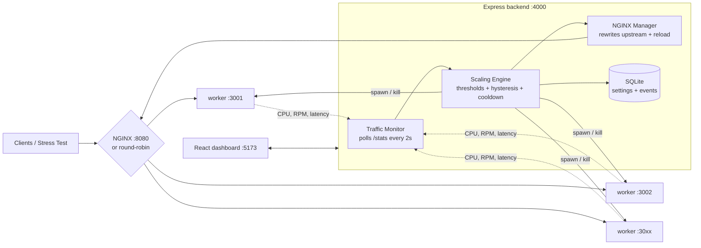

# Vajra Cloud

A self-hosted **auto-scaling and load-balancing platform**. Vajra Cloud runs a pool of worker processes, measures their real CPU load, adds or removes workers automatically, and spreads traffic across them through NGINX (or a built-in round-robin balancer). A React dashboard shows every decision as it happens.


## Architecture



## How auto-scaling works

1. **Measure:** every 2s the traffic monitor polls each worker's `/stats` and computes CPU %, requests/min and latency from the change since the last poll.
2. **Decide:** the scaling engine uses **average CPU across the worker pool**, the same signal AWS Auto Scaling target tracking uses. Because each worker is a single Node process, adding workers under the same load really lowers the average.
3. **Avoid flapping:**
   - A scale action needs **3 readings in a row** past the threshold (hysteresis).
   - After each action, a **15s cooldown** blocks further changes.
   - The pool always stays between the min and max instance limits.
4. **Act:** the engine spawns or stops worker processes, rewrites the NGINX upstream block, validates it (`nginx -t`) and hot-reloads NGINX.
5. **Audit:** every decision is written to SQLite with its reason, e.g. *"Scaled out: 2 → 3 workers (CPU 99% ≥ 70% for 3 consecutive checks)"*.

Every number on the dashboard is measured. None of it is simulated, except when the clearly labelled *Test Mode* CPU override is switched on.

## Quick start

Requires **Node.js 20.19+ or 22+**. NGINX is optional.

```bash
npm run install:all     # installs root, backend and frontend
cp backend/.env.example backend/.env
npm run dev             # starts backend (:4000) and dashboard (:5173)
```

Open http://localhost:5173.

## Run it in the cloud for free (GitHub Codespaces)

1. On GitHub, open the repo → **Code** → **Codespaces** → **Create codespace** (2-core is enough).
2. Wait about 2–3 minutes. The Codespace installs everything, builds the dashboard and starts the server.
3. The terminal prints a public link like `https://<name>-4000.app.github.dev`. Anyone can open it.

If the link asks visitors to sign in, open the **Ports** tab, right-click port 4000 → **Port Visibility → Public**. To restart the app, run `npm run codespace`.

The link stays live while the Codespace runs. Codespaces stop after 30 minutes of inactivity by default, which you can raise to 4 hours under *GitHub → Settings → Codespaces*. Free accounts get 120 core-hours a month, which is 60 hours on a 2-core machine.

On 2 cores, use the **Medium** stress test. **Heavy** asks for more CPU than the machine has, so latency keeps climbing even after scaling out.

## Demo script (≈ 3 minutes)

1. **Enable** the scaling engine. Two workers start (the configured minimum).
2. Click **Heavy** under *Stress Test*. This sends 70 req/s, and each request does 40ms of real CPU hashing (≈ 2.8 cores of work).
3. Watch:
   - Worker CPU hits ~100% and latency climbs as requests queue.
   - The engine scales out **2 → 3 → 4 → 5**. Each step shows as ▲ on the traffic chart and as an event with its reason.
   - The topology view grows new workers, and traffic spreads evenly across them.
   - CPU settles around 55–60% and latency drops from ~450ms to ~45ms.
4. Stop the test. CPU falls to 0%, and the engine scales back in to 2 workers.

## API

| Method | Endpoint | Description |
| --- | --- | --- |
| GET | `/api/health` | Backend health |
| GET | `/api/metrics` | Live CPU, RPM, latency, worker count |
| GET | `/api/metrics/traffic` | Last 3 minutes of traffic history |
| GET | `/api/instances` | Worker processes with per-worker CPU / RPM |
| GET | `/api/scaling` | Engine state, workers, NGINX, stress test |
| POST | `/api/scaling/enable` · `/disable` | Turn auto-scaling on/off |
| POST | `/api/scaling/scale-out` · `/scale-in` | Manual scaling |
| POST | `/api/scaling/stress` | Start stress test `{ preset: light\|medium\|heavy, durationSec }` |
| POST | `/api/scaling/stress/stop` | Stop stress test |
| POST | `/api/scaling/test-cpu` | Override the CPU reading `{ value: 0-100 \| null }` |
| GET/PUT | `/api/settings` | Min/max instances and thresholds |
| GET | `/api/events` | Audit log |

## Project structure

```
backend/src/
  services/scalingEngine.js   # scaling decisions + worker process lifecycle
  services/trafficMonitor.js  # polls workers, computes CPU / RPM / latency
  services/loadGenerator.js   # built-in stress test (open-loop, fixed rate)
  services/nginxManager.js    # NGINX detection, config generation, reload
  routes/                     # REST API
workers/worker.js             # the scaled service (/, /work, /stats, /health)
frontend/src/                 # React + Recharts dashboard
test-load.js                  # standalone CLI load generator
```
